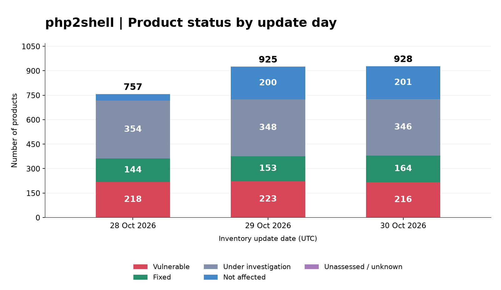

# php2shell vulnerabilities (CVE-2026-109618, CVE-2026-109619)

Operational information: 28 October 2026 16:46 CET 
Software list last status update: 30 October 2026 08:45 CET 
## TLP:CLEAR

This repository contains operational information regarding the critical PHP vulnerabilities tracked by CERT-EU as CVE-2026-109618 and CVE-2026-109619.

PHP is a widely used open-source server-side scripting language, so these vulnerabilities may affect a broad range of internet-facing web applications and products that embed or depend on PHP.

## Current status

<!-- inventory-statistics:summary:start -->
This repository tracks **928 products**, including **216 vulnerable** and **164 fixed**.
<!-- inventory-statistics:summary:end -->

On 21 October 2026, PHP published fixed releases for CVE-2026-109618 and CVE-2026-109619: PHP 8.5.12, 8.4.27, 8.3.36 and 8.2.35. PHP states that both vulnerabilities can allow unauthenticated remote code execution and that all PHP installations serving web requests are at risk, including PHP-FPM, Apache with mod_php, php-cgi, FrankenPHP and LiteSpeed. PHP considers the risk highest for mod_php, where an unauthenticated request can trigger exploitation before application code runs.

PHP describes CVE-2026-109618 as remote code execution via out-of-memory corruption during request cleanup, and CVE-2026-109619 as remote code execution via stale request-owned global state reused by a later request on the same worker. PHP 8.1 and older are no longer supported by the PHP project; distributions and LTS vendors may provide backported packages, and PHP has published minimal source backports for PHP 7.4, 8.0 and 8.1.

On 23 October 2026, PHP published an [informational advisory](https://www.php.net/archive/2026.php#2026-10-23-1) suggesting `session.upload_progress.enabled=0` until the next regular bugfix release to fully protect from an unlikely RCE vector (CVE-2026-115560). PHP will publish a full advisory with the next release; this repository does not track CVE-2026-115560 separately in the software list.

The impact is not limited to websites: PHP is also embedded in appliances, network devices, management interfaces and other vendor products where administrators may not be able to update PHP directly.

## Recommended actions

- Identify PHP-based applications and their runtime versions, with priority on internet-facing systems and web-serving SAPIs.
- Update to PHP 8.5.12, 8.4.27, 8.3.36 or 8.2.35, or apply vendor-provided backported packages.
- After updating, keep `session.upload_progress.enabled=0` until the next regular PHP bugfix release (PHP informational advisory of 23 October 2026, CVE-2026-115560), unless your application needs the feature and never changes `session.serialize_handler` at runtime.
- Check third-party images, appliances and embedded runtimes separately; for products that bundle PHP, apply vendor updates as soon as they become available.
- If immediate patching is not possible, follow PHP's temporary mitigations, including disabling `session.upload_progress`, restarting workers, and reviewing the official `memory_limit`, `post_max_size` and PHP 8.5 `fatal_error_backtraces` guidance. PHP states that these measures are not complete fixes.
- Monitor vendor advisories, internet-facing logs, and public exploit activity.

For additional information see:

- [CERT-EU Security Advisory 2026-018](https://cert.europa.eu/publications/security-advisories/2026-018/)
- [PHP security advisory: Critical remote code execution vulnerabilities, update now](https://www.php.net/archive/2026.php#2026-10-21-5)
- [PHP informational advisory: Session upload progress (23 October 2026)](https://www.php.net/archive/2026.php#2026-10-23-1)
- [List of advisories from other EU national CSIRT's](https://github.com/enisaeu/CNW/blob/main/advisories/2026/CNW-2026-04_php.md)
- [PHP2shell observations in the wild (TU Delft)](https://php2shell.delftintellab.com/)

## Repository contents

| Directory | Purpose |
| --- | --- |
| [detection_mitigation](detection_mitigation) | Contains detection and mitigation material for the vulnerabilities. |
| [software](software) | Contains inventory lists of software products with a PHP dependency potentially affected by the vulnerabilities. |
| [tools](tools) | Contains tools for using/generating files within this repo |
| [Community contributions](COMMUNITY_CONTRIBUTIONS.MD) | Community tools, tips, guides, and reference resources. |

The repository is being updated as the situation develops. Check back for updates.

## Software inventory statistics

<!-- inventory-statistics:start -->

Statistics as of **2026-10-30 (UTC)**, from the current SPDX inventory.

| Products tracked | Fixed | Vulnerable | Under investigation | Not affected | Unassessed / unknown |
| ---: | ---: | ---: | ---: | ---: | ---: |
| 928 | 164 | 216 | 346 | 201 | 1 |

[Counts by update day and per-CVE statistics (JSON)](software/statistics/inventory-statistics.json) | [Software list](software/software_list.md)

<!-- inventory-statistics:end -->

## Latest software status updates

| Date and time | Supplier | Product | Version (see Status) | Status CVE-2026-109618 / CVE-2026-109619 | Links |
|:------------------------|:---------|:--------|:--------------------:|:----------------------:|------:|
|2026-10-30 08:45:04 +0100|Broadcom|Carbon Black App Control Server|8.12.2 or 8.13.2|Fix|[source 1](<https://support.broadcom.com/web/ecx/support-content-notification/-/external/content/SecurityAdvisories/Enterprise-Security-Group-Advisory-for-PHP2Shell/39404>) [source 2](<https://knowledge.broadcom.com/external/article?articleNumber=459982>)|
|2026-10-30 08:45:04 +0100|Check Point|Check Point firewall web interfaces|sk1000302 hotfix: R81.10 / R81.20 / R82 / R82.10 / R82.20; Spark R81.10.17 build 996004992 or R82.00.11 build 998002823|Fix|[source](<https://support.checkpoint.com/results/sk/sk1000302>)|
|2026-10-30 08:45:04 +0100|Cisco|Cisco Expressway Select Series|15.5.21|Fix|[source](<https://sec.cloudapps.cisco.com/security/center/content/CiscoSecurityAdvisory/cisco-sa-php-october26-Jj384Daq>)|
|2026-10-30 08:45:04 +0100|Cisco|Cisco Expressway Series|15.5.21|Fix|[source](<https://sec.cloudapps.cisco.com/security/center/content/CiscoSecurityAdvisory/cisco-sa-php-october26-Jj384Daq>)|
|2026-10-30 08:45:04 +0100|Mautic project|Mautic official Docker images (PHP security rebuilds)|Mautic 5 / 6 / 7 Docker image rebuilds announced 2026-10-21|Fix|[source](<https://mautic.org/blog/critical-php-security-release-today-please-get-your-mautic-servers-ready/>)|

See the [full software status update history](software/changelog_software_list.md).

## Contributions welcome

If you have any additional information to share relevant to these PHP vulnerabilities, feel free to open a Pull request. New to this? [Read how to contribute in GitHub's documentation](https://docs.github.com/en/repositories/working-with-files/managing-files/editing-files#editing-files-in-another-users-repository).

For updates to the software list: our strong preference is to receive edits in the SPDX source files in `software/spdx/`. The Markdown list pages are generated automatically from those files. In case this proves too difficult: don't worry. We'll attempt to backport edits in the .md files to the SPDX source files, but without any guarantees. 

For a list of other contributions made by our community, see [Community contributions](COMMUNITY_CONTRIBUTIONS.MD).
